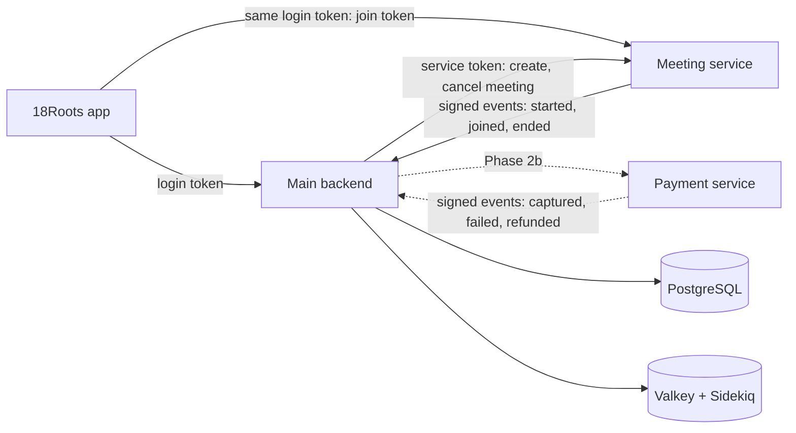

# 18Roots main backend

The backend the 18Roots app talks to: sign-in, doctors and booking, payments, consultations, care plans, medicine orders and notifications. It is Phase 2a in [../meeting-service/docs/ROADMAP.md](../meeting-service/docs/ROADMAP.md). It implements exactly the contract the app checks in `18roots_app/src/api/schemas.ts`.

Rails 8.1 API, Ruby 3.3, PostgreSQL, Valkey and Sidekiq. It uses the same setup as the meeting service, so both services run the same way.

## How it fits



- **Login tokens:**
  - Signed RS256 with this backend's private key, valid 15 minutes.
  - The audience covers this backend and the meeting service, so the app uses one token for both.
  - The meeting service checks them with the public key (`PLATFORM_JWT_PUBLIC_KEY`) and cannot create them.
  - The key is also published at `/.well-known/jwks.json`.
- **Meetings:**
  - After payment, a meeting is created in the meeting service through the outbox, using the backend's service token and the appointment ID as the idempotency key.
  - The meeting service's signed events then move the consultation to in progress, then ended.
- **Payments:**
  - `demo` moves no money and is confirmed by the app, but only when `DEMO_PAYMENTS` is on.
  - `payment_service` (Phase 2b) gives the app a checkout link. Only the payment service's signed webhook can mark the booking paid.

## Rules from the architecture guide

| Rule | How it is done |
| --- | --- |
| Two patients can't book the same time | A unique index on doctor and start time for active appointments. A real two-thread race test proves it. |
| The server rechecks the slot | Slots come from each doctor's weekly hours in Indian time and are rechecked when booking. An unpaid hold lasts 15 minutes. |
| Booking, payment and refund are idempotent | Same `Idempotency-Key` returns the same booking. Duplicate provider or meeting events are stored once by ID. A retried meeting creation reuses the appointment ID. |
| The app never proves payment | Real payments are confirmed only by the signed payment webhook. Demo confirmation is refused unless `DEMO_PAYMENTS` is on. |
| Separate statuses | The appointment (held, confirmed, completed, missed, cancelled, expired), the payment (created, paid, failed, refund pending, refunded) and the consultation (not created, scheduled, in progress, ended, cancelled) are kept apart, with allowed transitions. |
| Consent | Booking requires consent. Its time and version are stored on the appointment. |
| Audit records | Sign-ins, profile changes, care-plan views, bookings, confirmations, cancellations and refunds go to `audit_events`. |
| Least privilege | Patients see only their own records. The meeting service gets only appointment and user IDs and display names. |

## Security

- **Login codes:**
  - Six digits, stored only as a keyed hash.
  - Expire after 5 minutes, allow 5 attempts, and can be re-sent after 30 seconds.
  - Limited to 5 per phone number and 20 per IP address each hour.
- **Refresh tokens:**
  - Random, stored as a hash, and usable once.
  - Each use returns a new pair. Replaying an old one revokes the whole session family and is audited.
  - Sign-out revokes the family. The 15-minute access token simply expires.
- **Webhooks:** checked with HMAC-SHA256 over the timestamp and the body. Anything older than 5 minutes is rejected.
- **API rate limits:** per signed-in person, or per IP address for anyone else.
- **Production checks:** production refuses to start without its secrets, or with a test login code or demo payments, unless a test-server flag is set.
- **Logs:** codes, tokens and signatures are filtered out.

## Run it locally

You need Ruby 3.3, PostgreSQL and Valkey or Redis. Docker works too: the `Dockerfile` builds a non-root production image from `Gemfile.lock`.

```bash
cp .env.example .env    # then load it into your shell, or use your editor's env support
bundle install
bin/rails db:prepare db:seed
bin/rails server -p 3300
bundle exec sidekiq -C config/sidekiq.yml   # in a second terminal
```

The seeds add four doctors with weekly hours and a demo patient, **+91 98765 43210**. That patient has a care plan, a past consultation and two orders. With `OTP_FIXED_CODE=123456`, the login code is always 123456.

**Point the app at it.** In `18roots_app/.env`:

```
EXPO_PUBLIC_API_MODE=live
EXPO_PUBLIC_API_URL=http://YOUR-COMPUTER-IP:3300
EXPO_PUBLIC_MEETING_API_URL=http://YOUR-COMPUTER-IP:3100
```

**For video calls**, run the meeting service with these settings:
- `PLATFORM_JWT_PUBLIC_KEY` set to this backend's public key (from `/.well-known/jwks.json`, or from the PEM)
- `PLATFORM_JWT_ISSUER=18roots-main-app`
- `MEETING_CREATOR_ROLES=service`
- `EVENTS_WEBHOOK_URL=https://<this backend>/webhooks/meetings`
- `EVENTS_WEBHOOK_SECRET`, the same value as `MEETING_EVENTS_SECRET` here

The meeting service requires HTTPS for events in production.

## API

All routes are under `/v1` and use the app's camelCase JSON.

| Area | Routes |
| --- | --- |
| Sign-in | `POST auth/otp`, `auth/verify`, `auth/refresh`, `auth/logout` |
| Profile | `GET`, `PATCH me` |
| Home | `GET home`: sections chosen by the server |
| Care plan | `GET care-plan`, `POST care-plan/doses/:id`, `PUT care-plan/goals/:id` |
| Doctors | `GET doctors?query=&language=`, `GET doctors/:id`, `GET doctors/:id/slots?date=YYYY-MM-DD` |
| Booking | `POST bookings` (`Idempotency-Key`, `consent: true`), `GET bookings/:id`, `POST bookings/:id/confirm-payment` (demo only) |
| Consultations | `GET consultations?scope=upcoming\|past`, `GET consultations/:id`, `POST consultations/:id/cancel` |
| Orders | `GET orders?status=all\|active\|delivered`, `GET orders/:id` |
| Notifications | `GET notifications`, `POST notifications/:id/read`, `POST notifications/read-all` |
| Other services | `POST /webhooks/meetings`, `POST /webhooks/payments`, `GET /.well-known/jwks.json` |
| Health | `GET /health/live`, `GET /health/ready` |

Errors look like `{ "error": { "code": "slot_unavailable", "message": "..." } }`.

## Tests

```bash
bundle exec rspec
```

There are 31 examples:
- sign-in and token security
- booking, including a real two-patient race
- payments and cancellations
- meeting and payment webhooks
- the outbox and maintenance jobs
- all content endpoints

The specs save real responses to `spec/contract/fixtures`. When `18roots_app` sits beside this folder, its `__tests__/backendContract.test.ts` checks every fixture against the app's own schemas.

**Whole-system check (11 November 2026):** this backend and the meeting service ran in production mode with both Sidekiqs, the local LiveKit and HTTPS. All 25 checks passed:
1. Sign-in
2. Booking and a retried booking
3. Demo payment
4. Meeting created automatically
5. The patient's login token accepted by the meeting service, and a LiveKit join token issued
6. A LiveKit join event moving the consultation to in progress
7. Ending the call: the missed-by-doctor flag and its notification
8. Cancellation with refund and meeting cancellation
9. Refresh-token rotation and theft detection

## Not done yet

- **SMS:** `SMS_PROVIDER=log` only. Pick and integrate a provider, for example MSG91 or Twilio, with DLT registration for India.
- **Payment service (Phase 2b):** the client and webhook here follow the contract in `app/services/payments/payment_service_client.rb`.
- **Doctor and admin portals:** these will add doctor logins, editing care plans and orders, and refund review for `needs_review` appointments.
- **Push notifications** from the server. Reminders are local on the phone today.
- **Paid hosting:** backups, monitoring, alerts, a load test and a security review.
- **Legal review** of consent text, retention and the Telemedicine Practice Guidelines.
- **Deployment:** `render.yaml` and the CI workflow haven't been run yet.
