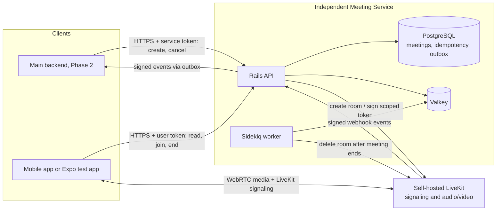

# Meeting Service: idea, architecture, and end-to-end flow

## Product idea

The Meeting Service owns the lifecycle of a one-to-one online consultation between a doctor and a patient. It is Phase 1 of the 18Roots plan in [ROADMAP.md](ROADMAP.md). The main backend (Phase 2) remains responsible for accounts, appointments, payments and its own business data. Once an appointment is confirmed, it asks this service to create the meeting, passing appointment and user references. This service reports back with signed events. The two never share a database.

The service stores the minimum data needed to create a room, authorize its two participants, and track whether the meeting is scheduled, ready, active, or finished. Rails keeps the LiveKit API secret private and issues short-lived tokens that only allow a specific participant into a specific room. LiveKit carries the live audio/video; Rails does not proxy the media.

For the local MVP, the Expo app is a test client. It can select Doctor or Patient so two devices can exercise the flow. That selector is not a login system. A real 18Roots app must send a signed platform token and derive the role and user reference from its authenticated session.

## System at a glance



PostgreSQL is the source of truth for the meeting lifecycle. Valkey, an open-source Redis-compatible store, supports Sidekiq and short-lived operational work. The separate LiveKit connection is direct from each mobile client to the media server, which keeps video traffic out of the Rails API.

## End-to-end consultation flow

```mermaid
sequenceDiagram
  autonumber
  participant M as Main backend
  participant D as Doctor app
  participant P as Patient app
  participant API as Rails API
  participant DB as PostgreSQL
  participant LK as LiveKit
  participant W as Sidekiq

  M->>API: Create meeting after payment (service token, idempotency key)
  API->>DB: Save meeting, participants and meeting.created event
  API-->>M: Meeting ID, scheduled
  M-->>D: Appointment with meeting ID
  M-->>P: Appointment with meeting ID
  D->>API: Prepare room
  API->>LK: Create named room (server secret only)
  API->>DB: scheduled → ready
  API-->>D: Room ready
  P->>API: Request patient join token
  API->>API: Verify patient identity matches meeting participant
  API-->>P: Short-lived, room-scoped LiveKit token + server URL
  D->>API: Request doctor join token
  API-->>D: Short-lived, room-scoped LiveKit token + server URL
  D->>LK: Connect and publish camera/microphone
  P->>LK: Connect and publish camera/microphone
  LK-->>API: Signed participant/room webhooks
  API->>DB: Deduplicate event; update status, join times and outbox
  W->>M: Signed meeting.started and participant.joined
  Note over D,P: Either person can leave without ending the other person's call
  D->>API: End meeting
  API->>DB: Mark ended; add meeting.ended and room cleanup to the outbox
  W->>LK: Delete LiveKit room (retried if unavailable)
  W->>M: Signed meeting.ended with join times and who ended it
```

### User-visible states

1. **Scheduled:** the API has accepted the appointment reference and both participants. There is no usable room yet.
2. **Ready:** the LiveKit room exists and an authorized participant can request a token.
3. **In progress:** LiveKit reports that a participant joined or the room started.
4. **Ended:** someone explicitly ends the consultation, or LiveKit reports that its room finished. Cleanup removes the LiveKit room.
5. **Cancelled:** the main backend cancelled the appointment, for example after a refund. The room is removed.
6. **Failed:** reserved for setup failures; nothing sets it yet.

Leaving the call on one phone only disconnects that participant. Ending the meeting is a separate action that closes access for both people and schedules room cleanup.

## Ownership and data boundaries

| This service owns | The 18Roots platform owns |
| --- | --- |
| Meeting ID and LiveKit room name | Account, doctor, and patient records |
| External appointment reference | Appointment scheduling and changes |
| Two meeting participant references and roles | Login, password, and session lifecycle |
| Meeting status and start/end times | Medical records and clinical notes |
| Idempotency records and sanitized webhook event IDs | Consent and patient-facing policy records |

Do not put diagnosis, notes, credentials, or full medical records in meeting metadata or LiveKit room metadata. The local starter does not enable recording or transcription.

## API responsibilities

- `POST /api/v1/meetings`: accept one doctor, one patient, and an external appointment reference. Require an idempotency key so a retry cannot create duplicate meetings. Only roles in `MEETING_CREATOR_ROLES` may call it; production uses the main backend's `service` role.
- `GET /api/v1/meetings/:id`: status and join times for a participant or the main backend.
- `POST /api/v1/meetings/:id/prepare`: create the LiveKit room and make the meeting ready. Safe retries should converge on the same room.
- `POST /api/v1/meetings/:id/join-token`: verify caller role and identity against the meeting, then return a short-lived room-scoped credential. Never return the LiveKit API secret.
- `POST /api/v1/meetings/:id/end`: end the meeting and queue room cleanup. Disconnecting is deliberately not equivalent to ending.
- `POST /api/v1/meetings/:id/cancel`: main backend only, for cancelled or refunded appointments.
- Outbound events: `meeting.created`, `meeting.started`, `meeting.ended`, `meeting.cancelled`, `participant.joined` and `participant.left`, signed with HMAC-SHA256 and retried for about a day.
- `POST /api/v1/livekit/webhook`: verify LiveKit's signed raw-body digest, save a unique event ID, and apply lifecycle updates once.
- `GET /health/live` and `/health/ready`: distinguish a running web process from one whose database/Redis dependencies are ready.

See [API.md](API.md) for request examples, the JWT contract, events and response codes, and [openapi.yaml](openapi.yaml) for the machine-readable contract.

## Build and rollout plan

The current `meeting-service/` project supplies a runnable local-development foundation. Work through these stages:

1. **Local environment:** install Docker Desktop or Docker Engine with Compose; copy `.env.example` to `.env`; start PostgreSQL, Redis, LiveKit, Rails, and Sidekiq with Compose; confirm `/health/ready`.
2. **API contract:** use the documented create → prepare → token → end endpoints. Keep the platform integration based on external references and signed tokens; do not connect the service to the main application's database.
3. **Two-device media check:** build the Expo native development client (Expo Go does not include the required native LiveKit/WebRTC module), configure each device's reachable API and LiveKit host, and join once as Doctor and once as Patient.
4. **Lifecycle check:** verify webhook events update timestamps, duplicate events do not duplicate state changes, leave does not terminate the other participant, and end queues room deletion.
5. **Pre-production hardening:** done in code on 10 November 2026: key rotation and public-key tokens, a transactional outbox, scheduled purges, per-user rate limits, a lockfile and CI. Still needed: the main backend's real token issuer, HTTPS/WSS and a public LiveKit address with TURN, managed PostgreSQL and Valkey with backups, metrics and alerts, runbooks, and privacy and clinical review. [ROADMAP.md](ROADMAP.md) tracks these.

The included Docker Compose setup is for local development. The API image is non-root and suitable as a starting image, but production deployment also needs environment-specific networking, secrets, persistence, monitoring, and an orchestrated rollout. Never expose the local `devkey` / `secret` pair to a public network.

## What is intentionally outside the first release

- Appointment creation, rescheduling, and cancellation rules (the main backend decides; this service only executes a cancel)
- A user login or a doctor/patient directory
- Group calls, waiting rooms, chat, recording, transcription, or screen sharing
- Payments (a separate payment service, Phase 2), clinical documentation, and appointment reminders
- A production deployment platform or automated infrastructure provisioning

These belong in later stages after the core one-to-one call has been integrated and validated.
