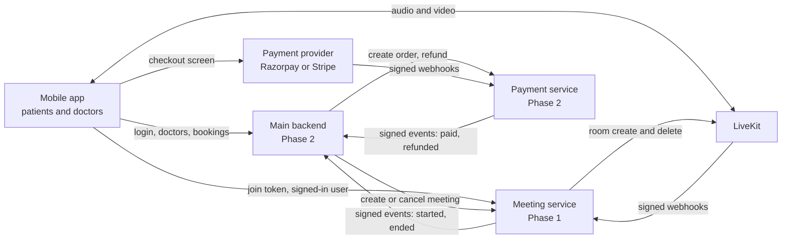

# 18Roots roadmap: meeting service, application, payments

18Roots is planned as a mobile application backed by separate services. Each service owns its own database and talks to the others only through HTTPS APIs and signed events.

| Phase | What gets built | Status |
| --- | --- | --- |
| 1 | **Meeting service**: one-to-one video consultations | Code complete. Hosting, a real call and load testing still to do. |
| 2 | **The application**: main backend, payment service and mobile app | Mobile app in `../18roots_app` (10 November 2026). Main backend in `../main-backend` (11 November 2026), tested with the meeting service. Payment service not started. |

## How the pieces fit

A booking goes like this:

1. The patient picks a doctor and a time in the app. The main backend holds the slot.
2. The main backend asks the payment service for an order. The app shows the payment provider's checkout screen.
3. The provider tells the payment service that the payment succeeded. The payment service tells the main backend.
4. The main backend confirms the appointment and creates the meeting with its service token.
5. At the appointment time, each person taps Join. The app asks the meeting service for a join token, using the person's own login token.
6. The meeting service sends the main backend `meeting.started`, then `meeting.ended` with the join times.
7. The main backend marks the consultation complete. If the doctor never joined, it asks the payment service for a refund. If the appointment is cancelled, it cancels the meeting and refunds.

**Ownership rules:**
- The main backend owns users, doctors, appointments and the rules about who can book, cancel or get a refund.
- The meeting service owns rooms, join tokens and call times.
- The payment service owns orders, payments, refunds and the payment ledger.
- No service reads another service's database.

## Phase 1: meeting service

### Done in code

- Create, read, prepare, join, end and cancel meetings.
- **Only the main backend creates and cancels meetings.** Doctor or patient creation is a test setting (`MEETING_CREATOR_ROLES`).
- **Lifecycle events go to the main backend:** `meeting.created`, `meeting.started`, `meeting.ended`, `meeting.cancelled`, `participant.joined`, `participant.left`. Events are signed with HMAC-SHA256 and retried for about a day. They are written in the same database transaction as the change, so a crash cannot lose one.
- Room cleanup uses the same outbox, so it survives a queue outage.
- Expired idempotency keys, old webhook records and delivered events are purged hourly. No extra scheduler service is needed.
- Login tokens can use a shared secret with a second secret during rotation, or the main backend's public key (RS256 or ES256). With a public key, the meeting service cannot create login tokens.
- **Rate limits are per user, not per IP address.** Many phones on one mobile network no longer share a limit. LiveKit webhooks have their own limit.
- The video server is no longer called while a database row is locked.
- `Gemfile.lock` pins every gem. Puma is upgraded to 7.2.1, which fixes two advisories.
- The API contract is in [openapi.yaml](openapi.yaml), and CI is in `.github/workflows/ci.yml`.

### Still to do before Phase 1 is finished

| Step | Who | Done when |
| --- | --- | --- |
| Deploy to Render and LiveKit Cloud, together with the main backend ([render-deploy/DEPLOY.md](../../render-deploy/DEPLOY.md), through Docker Hub; no GitHub needed) | You | `/health/ready` answers on the Render address |
| Real call between two phones on different networks | You and a teammate | Both see and hear each other; the meeting shows `ended` |
| LiveKit webhook from the real server | You | The meeting moves to `in_progress` without anyone calling the API |
| Load test of the API (k6 or similar) | Team | 200 meetings an hour created and joined with no errors |
| Paid hosting with backups and alerts | Team | Database backups run; a failed health check alerts someone |
| Security review | Outside reviewer | No high findings open |

## Phase 2: the application

These can be built in parallel once Phase 1's API is stable. Each piece is its own project.

### 2a. Main backend

**Built:** `../main-backend` (see its README). It has OTP login, RS256 tokens and JWKS, doctors and slots, race-safe booking with demo payments, cancellation with refunds, meeting creation and events, care plans, orders, notifications and audit records. It has 31 specs, and a 25-check run with the meeting service. Still to do: a real SMS provider, the doctor and admin portals, and server push notifications.

- Phone OTP login. Issues short-lived login tokens (15 minutes plus a refresh token), signed with its private key and published as a JWKS (public key list).
- Doctor profiles, verification, availability and slots.
- Appointments: hold a slot, confirm after payment, reschedule, cancel.
- Creates and cancels meetings with a service token. Receives meeting and payment events.
- Admin screens for support.

### 2b. Payment service

- Open-source code you own, talking to a payment provider. **No payment provider is open source.** Moving real money in India needs a licensed provider, such as Razorpay, Cashfree or Stripe.
- Orders with idempotency keys, the provider's checkout, signed provider webhooks, a double-entry ledger, refunds and daily reconciliation.
- Card details never touch your servers. The provider's checkout handles them, which keeps PCI scope small.
- Later: payouts to doctors (for example Razorpay Route).

### 2c. Mobile app

**Started:** the patient app's front end is in `../18roots_app` (see its README). It has the five tabs from the design, sign-in, booking with payment, the video call, orders, reminders, and English and Tamil. It runs on a built-in demo backend until the main backend exists. Its `src/api/schemas.ts` is the contract the main backend should follow.

- One React Native and Expo app with a patient mode and a doctor mode, or two apps. This is a decision for you to make. The architecture guide plans a web portal for doctors, so the app is patient-only for now.
- Login, doctor search, booking, payment, waiting room and call, history and notifications.
- The call screen reuses the Phase 1 test client's LiveKit code.
- Release signing and a Play Store listing. iOS needs a Mac and an Apple developer account.
- Push notifications need Firebase Cloud Messaging on Android, which is a closed Google service. No open-source option reaches Android phones reliably.

## Decisions you need to make

| Decision | Options | Needed by |
| --- | --- | --- |
| Payment provider | Razorpay (UPI, India), Cashfree, Stripe (international) | Start of 2b |
| One app or two | One app with roles, or separate patient and doctor apps | Start of 2c |
| Production hosting | Render paid, AWS or another cloud, your own servers | End of Phase 1 |
| Video server | LiveKit Cloud (paid per minute) or self-hosted LiveKit with TURN | End of Phase 1 |
| Login provider | Your own OTP backend with an SMS provider, or a hosted identity service | Start of 2a |

## Legal checks before real patients

- India's Telemedicine Practice Guidelines (2020): doctor registration, consent and record-keeping.
- India's Digital Personal Data Protection Act (2023): consent, purpose limits, retention and breach reporting.
- RBI payment rules are handled mostly by the payment provider, but refunds and disputes are your process.

A lawyer should confirm these. This list is a starting point, not legal advice.
